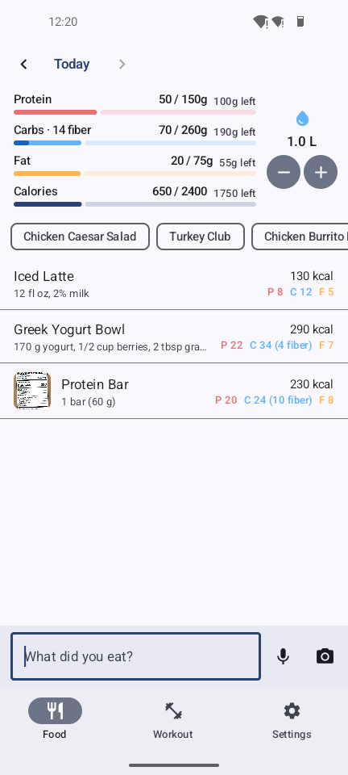

# macroman

A food and workout log for Android where you type, say, or photograph what you ate and an LLM fills in the
macros. I wanted to get from "I just ate something" to "it's logged" in as few taps as possible, so the app
opens straight onto the log with the keyboard up.

<p align="center"></p>

<sub>The demo runs on an emulator against Gemma 4 on a desktop through Ollama. The model's thinking time is
sped up; the real wait was about 40 seconds. With Claude a text entry takes a few seconds.</sub>

## What it does

- **Food:** describe a meal in your own words, use the phone's voice typing, or take a photo of the plate or the
  nutrition label. You get back a list of items with calories, protein, carbs, fat and fiber, and can fix
  anything before saving.
- **Portion slider:** each item has a 0.5x–2x slider. The numbers follow it straight away, and a small model
  rewrites the amount text to match ("150 g" becomes "225 g").
- **Suggestions:** a row of one-tap re-logs based on what you ate around this time of day over the last week.
- **Photos:** the picture each entry came from is kept on the phone, shown as a thumbnail, and opens
  full-screen on tap. There's a storage cap in Settings (1 GB by default); the oldest pictures are dropped first.
- **Workouts:** the same idea for training: "bench 3x8 185, then 20 min incline walk".
- **Water:** a running daily total with ±0.5 L buttons.
- **Daily targets** for calories and macros, with progress bars.
- **Hand for scale:** photograph your hand next to a tape measure once, and later food photos with your hand in
  them get sized against it.
- **Backup:** pick a file once, for example in Google Drive through the normal Android save dialog, and the
  app keeps it up to date with your log and settings. API keys and photos aren't included. You can restore
  from it on a new phone.

Everything is stored on the phone. What leaves it is the request to the model provider (your text, plus a
downscaled copy of the photo with its metadata stripped) and, if you turn it on, the backup file. Android's own
cloud backup is turned off for the app, so your API key doesn't end up there.

The numbers are a language model's estimates, and they can be wrong, sometimes by a lot. This is a logging tool,
not medical or dietary advice; if you're managing a health condition, go by your doctor or dietitian.

## Model providers

You bring your own API key. Pick a provider in Settings:

| Provider | Status |
|---|---|
| Anthropic (Claude) | The default, and what I use every day. Tested. |
| Ollama / LM Studio | The demo above ran on Ollama with `gemma4:26b-a4b`, the best local model I found ([comparison](study/README.md)). Text logging and the portion slider work; photos haven't been tried. |
| OpenAI, Google Gemini, OpenRouter, other OpenAI-compatible servers | Untested. Written against their docs and should work, but I haven't tried them. |

Everything except Anthropic goes through one OpenAI-compatible client. It asks for strict JSON output first and
falls back to looser modes if a server rejects that, then remembers what worked. The prompts were tuned on
Claude, so expect other models to be less accurate, especially with photos. There's a rough comparison of local
models in [`study/`](study/README.md).

Plain `http://` is only allowed to addresses on your own network, so a model server at home works but a key
never goes out unencrypted.

## Building

It targets Android 14+ (minSdk 34) and has only been run on a Pixel 8. There's no Play Store build; you build
it and install it yourself.

You need JDK 17 or newer and the Android SDK (platform 35, build-tools 35). Android Studio works, or just the
command-line tools:

```sh
./gradlew assembleDebug
adb install -r app/build/outputs/apk/debug/app-debug.apk
```

Then open Settings in the app, pick a provider, and paste a key.

## Layout

```
app/src/main/java/com/dirkraft/macroman/
  ai/MacroAi.kt       prompts and JSON schemas
  ai/Backends.kt      Anthropic and OpenAI-compatible clients
  data/               Room database, settings, photo storage
  ui/                 Compose screens
  MainViewModel.kt
study/                scoring local models against the food prompt
docs/demo/            scripts that recorded the demo
```

Kotlin, Jetpack Compose, Room, and the Anthropic Java SDK. No analytics or tracking.

## License

MIT, see [LICENSE](LICENSE). Dependency licenses are checked with Cash App's
[Licensee](https://github.com/cashapp/licensee) plugin: `./gradlew licensee` (also part of `./gradlew check`)
fails if any dependency, including transitive ones, has a license other than Apache-2.0 or MIT. As of November
2026 that's 123 artifacts, 118 Apache-2.0 and 5 MIT.

Before the repo went public I also ran two one-off scans (November 2026):

- [ScanCode Toolkit](https://github.com/aboutcode-org/scancode-toolkit) 32.5.0 over all 70 committed files. The
  only license text or copyright notices it found are this repo's own `LICENSE` and the standard Gradle wrapper
  (`gradlew`, `gradlew.bat`, Apache-2.0). The nutrition labels in `study/` and the demo are made up and rendered
  from HTML here.
- [gitleaks](https://github.com/gitleaks/gitleaks) 8.30.1 over the full git history and the working tree: no keys
  or tokens.
